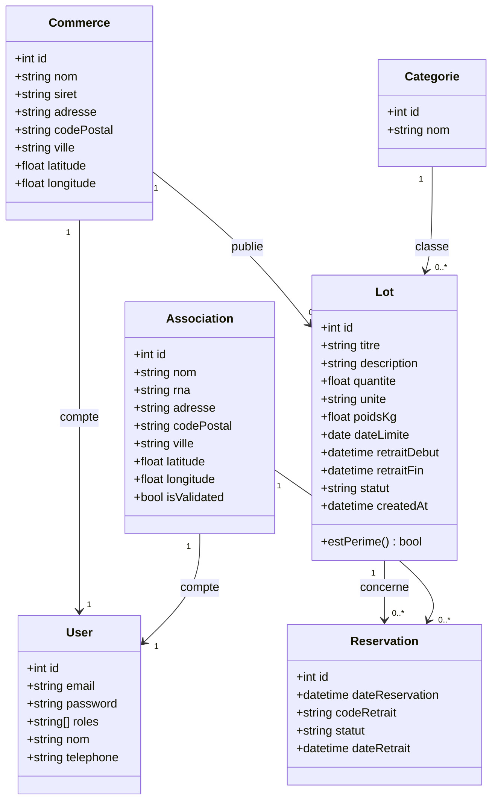
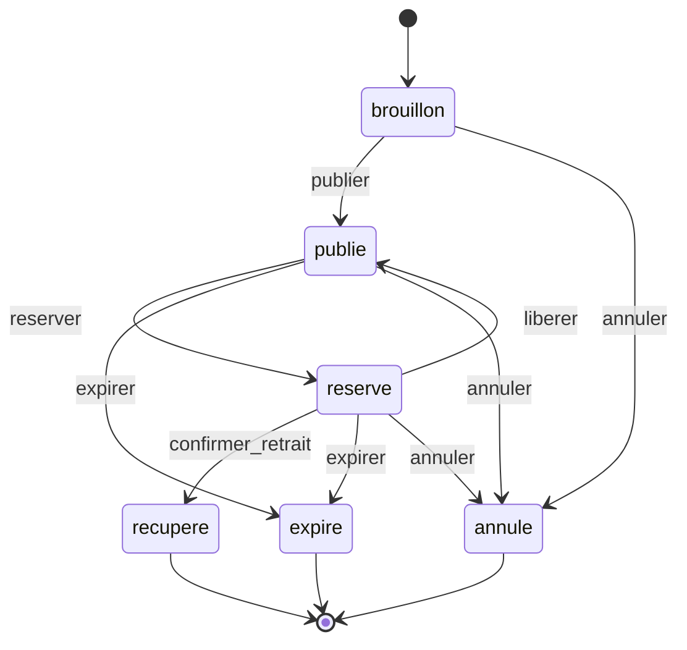
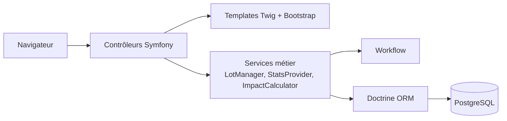

# Conception — ReGeev

Les diagrammes sont écrits en Mermaid : GitHub les affiche directement.

## Diagramme de classes

## Cycle de vie d'un lot

Ce cycle est implémenté avec le composant Workflow de Symfony
(`config/packages/framework.yaml`) et piloté par `App\Service\LotManager`.

## Architecture

## Circuit des données d'impact

1. `StatsProvider` lit en base les réservations au statut « récupérée ».
2. `ImpactCalculator` agrège ces lignes : total, repas équivalents, répartition par mois, catégorie et ville.
3. Le résultat est exposé de trois façons : page `/impact` (graphiques), `/api/stats` (JSON), `/impact/export.csv`.

`ImpactCalculator` ne dépend ni de la base ni du framework : je peux le tester unitairement.
